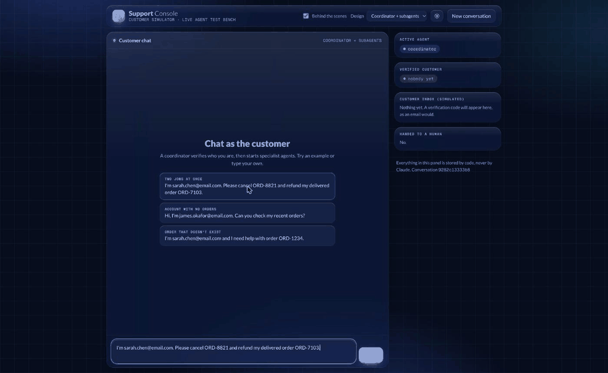

# Customer Support Agent

A customer support agent built as a capstone for the Dev Compass Claude Certified Architect course: Claude answers customers, looks up accounts and orders, and handles cancellations and refunds. Identity checks, refund limits and escalation to a human are enforced **in code**, not just in the prompt. It runs two ways: agents that hand the customer to each other, and a coordinator that starts specialist subagents in parallel.

Everything runs on fake data (`mock_data.py`). No real customers or payments.



*The Support Console demo: the customer types on the left; the right panel and the "behind the scenes" lines show what the customer never sees (verification, inbox, subagent briefings and structured reports). [Full-size screenshot](docs/console.jpg).*

## What it does
| Capability | Where |
|---|---|
| Agentic loop (keeps going while Claude asks for a tool; stops on `end_turn`) | `agent.py` |
| 13 tools with descriptions that say what, when, when not, and what comes back | `tools.py` |
| Structured errors: `errorCategory`, `isRetryable`, plain-English `message` | `tool_runner.py` |
| Identity verification: a 6-digit code to the customer's email or phone, then `verify_identity` | `tool_runner.py` |
| Programmatic gate: order and account tools refuse to run until verification, and only for the verified customer's own data | `tool_runner.py` (`_check_access`) |
| Session state: who is verified, active agent, escalations; stored on disk so a new process still knows | `session_store.py` |
| Hooks: block tools outside an agent's scope, stop refunds over $100 and hand them to a person, escalate automatically after locked verification | `hooks.py` |
| Escalation: structured handoff for a human (customer, issue, what was tried, suggested next step) | `tool_runner.py` |
| Scoped agents: customer_service, order_processing, refund_processing, each with only its own tools | `agents.py` |
| MCP server: the same tools behind the Model Context Protocol (stdio), gate and hooks included | `mcp_server.py`, `.mcp.json` |
| Claude Agent SDK versions of both designs | `sdk_agent.py`, `coordinator.py` |
| Coordinator with parallel specialist subagents, each returning a structured report built by code from the real tool results | `coordinator.py` |
| Support Console demo page with a "behind the scenes" view, light and dark | `composer.py`, `composer.html` |

## Setup
```bash
python3.12 -m venv .venv
.venv/bin/pip install -r requirements.txt
cp .env.example .env        # then put your own ANTHROPIC_API_KEY in .env
```

## Run it
```bash
.venv/bin/python agent.py        # terminal chat, agents hand off (base Anthropic API)
.venv/bin/python coordinator.py  # terminal chat, coordinator + subagents (Agent SDK)
.venv/bin/python composer.py     # demo page at http://127.0.0.1:8000 (dropdown picks the design)
```
In the demo, the verification code arrives in the fake "inbox" panel on the right. Try:
> I'm sarah.chen@email.com. Please cancel ORD-8821 and refund my delivered order ORD-7103.

Customers in the fake data: Sarah Chen (`sarah.chen@email.com`, has orders) and James Okafor (`james.okafor@email.com`, no orders).

## Tests
```bash
.venv/bin/python test_errors.py        # errors, gate, verification, scopes   (free, no API calls)
.venv/bin/python test_mcp_server.py    # starts the MCP server as a client    (free)
.venv/bin/python test_sdk_agent.py     # SDK setup and hooks                  (free)
.venv/bin/python test_coordinator.py   # coordinator setup, report builder    (free)
.venv/bin/python test_coordinator.py --live   # real two-job run with Claude   (uses API credits)
```

## Design choices worth knowing
- **Rules that must always hold live in code.** The prompt tells Claude to verify first; the gate makes sure nothing happens if it doesn't. Hooks add the refund limit.
- **Subagents start blank.** The coordinator's briefing carries everything they need. Gates still check the stored session, so a briefing can never grant permission.
- **Reports come from code, not from the model.** A hook records every real tool result; the report handed back to the coordinator is built from that record.
- **Order IDs are cleaned once** (`' ord-8821 '` becomes `ORD-8821`) before the gate and the tool see them.
- **Unshipped orders can't be refunded.** `issue_refund` returns a `business` error that points the agent to `cancel_order`.

## Differences from the course reference code
- Tools are named for their action (`lookup_order_status`, `issue_refund`) and refunds take a reason code and amounts in cents.
- Verification is a code sent to the customer instead of a name lookup, so a name alone never unlocks an account.
- The identity gate is enforced inside the MCP server too, by reading the stored session, not only in the calling application.
- Uses `MCPServer` from `mcp` 2.x (the course shows `FastMCP`).

## Known limits
- The fake data does not change: a cancelled order still reads as "processing" in later lookups.
- The error path of a live subagent run (a specialist hitting a real tool failure) is covered by offline tests only.
- Reports are built by code, but the coordinator is not yet re-delegating when a report shows a gap.
